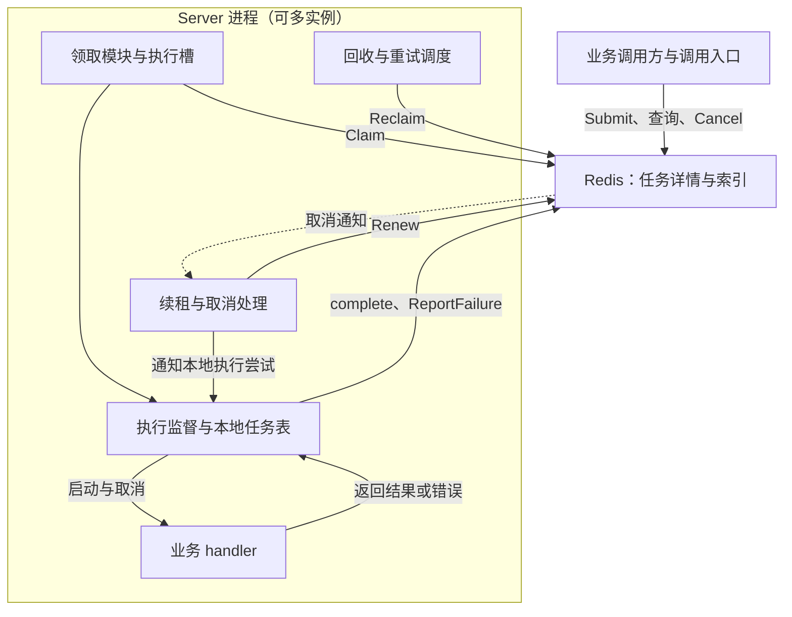

# TaskHarbor 项目概览

## 1. 项目简介

TaskHarbor 是一个使用 Go 开发的异步任务调度与执行平台。业务调用方提交任务后，执行实例从 Redis 领取任务，调用业务提供的 handler，并记录成功结果或失败原因；平台负责执行并发限制、续租、失败重试、取消和失联任务回收。

项目将业务处理与任务管理分开：handler 实现具体业务，平台维护任务生命周期与执行权。调用方可以通过 task_id 查询状态与结果，无需在提交请求中等待业务执行完成。

当前仓库模块为 github.com/wang-kang-tuoinai/TaskHarbor，Go 包名为 taskq。项目处于早期实现阶段：已有操作契约、字段说明、Server 基础结构及本地单元测试，尚未完成从提交到执行结束的完整流程。本文的架构和业务流程描述第一版目标，不代表这些能力已全部实现。

## 2. 项目目标与非目标

### 项目目标

- 作为展示 Go 后端与分布式系统能力的工程作品，能够解释并验证任务执行权、租约、并发竞争与故障恢复机制。
- 建立清晰的任务生命周期，让状态、执行身份和 Redis 索引保持一致。
- 支持多个 Server 实例处理同一逻辑队列，并限制每个实例的本地 handler 并发。
- 用可复现的测试验证正常执行、网络结果未知、旧 Worker 上报、取消与完成竞争、租约回收等关键场景。
- 保持实现可读、可维护，围绕实际问题选择技术，不提前构建通用框架。

### 第一版范围

| 能力 | 第一版目标 |
| --- | --- |
| 提交与查询 | 提交任务、识别相同 ID 的重复提交，按 task_id 查询状态和结果；查询入口仍待实现 |
| 执行 | 注册 handler，领取任务，限制本地并发，提交成功结果或失败原因 |
| 超时 | 启动 handler 时开始本地 execution_timeout 计时，超时后停止续租、发出取消信号并上报失败 |
| 重试与回收 | 有限次数重试；租约到期恢复；重试等待到期后重新进入 pending |
| 取消 | 将未终结任务直接置为 canceled，并尽力通知正在执行的实例 |
| 存储 | 仅使用 Redis，任务详情与执行索引由 Lua 原子维护 |

第一版以七个核心操作 Submit、Claim、complete、ReportFailure、Renew、Cancel、Reclaim 及其集成为重点。调用入口的具体传输形式尚未完整实现，本文不预设独立 HTTP 服务或完整 SDK。

### 非目标与明确保留的边界

- 第一版不引入 MySQL 或其他消息中间件，不实现跨存储双写。
- 不以工作流编排、周期任务、任务聚合、管理后台等扩展能力作为第一版交付要求。
- 不承诺业务副作用恰好发生一次，也不承诺每个任务的 handler 必定启动；授予执行权会消耗有限的尝试预算。
- 不强制终止不响应 context 的 goroutine；取消或超时不代表 handler 已退出。
- 暂不解决取消通知先于本地登记导致 handler 仍可能启动的窗口。
- 暂不实现 Server 本地租约有效期维护和迟到 Claim 响应的租约到期保护。Redis 仍会拒绝失效身份的续租和上报，但旧 handler 可能继续运行并产生副作用。
- 暂不自动检测、对账或修复 Lua 部分写入留下的不完整状态。
- Redis 的持久化、复制与故障恢复配置尚待明确，不作任何故障下都不丢任务的承诺。

## 3. 技术栈

| 技术 | 用途与当前情况 |
| --- | --- |
| Go | 核心实现语言；go.mod 当前声明 Go 1.26.0 |
| goroutine、channel、sync | 执行并发、执行槽和共享状态管理；已有带锁的本地执行记录表及配置结构，执行调度尚待接入 |
| context、time | 向 handler 传递取消信号，监督单次执行超时，驱动续租与回收；生命周期循环尚待实现 |
| Redis | 第一版任务状态的权威存储，保存任务详情、等待及执行索引、租约和重试到期时间 |
| Redis Lua | 将条件检查、状态修改、执行身份更新与索引迁移放在同一原子边界内；脚本尚待实现 |
| go-redis/v9 | Go Redis 客户端；go.mod 当前直接依赖 v9.23.0 |
| Redis 取消通知通道 | 按 owner_id 向对应 Server 推送尽力而为的取消通知；发布、订阅流程尚待实现，通知不替代存储状态检查 |
| encoding/json、testing | 已用于业务结果序列化及 Server 本地逻辑的单元测试 |

这里的版本来自仓库配置，不表示已验证某个部署环境。具体依赖以 [go.mod](../go.mod) 为准。

## 4. 整体架构

第一版由业务调用方、调用入口、执行实例、业务 handler 和 Redis 组成。Server 在本项目中是执行服务实例，不等同于 HTTP 服务。一个进程可以运行多个 handler 协程，多个 Server 进程可以共享 Redis 中的逻辑队列。

以下为目标架构；Server 内部模块是职责划分，不要求分别部署为服务，也不要求立即拆成独立 Go 包。

| 组件 | 主要职责 |
| --- | --- |
| 业务调用方与调用入口 | 提供 task_id、任务类型、payload 和执行配置；提交、查询、取消任务 |
| 领取模块 | 先取得本地执行槽，再发起 Claim；领取失败或无任务时归还尚未转交 handler 的槽 |
| 执行监督 | 调用 handler，处理返回结果与超时竞争，发起上报，并管理实际退出后的资源释放 |
| 本地任务表 | 区分 task_id 与 attempt_token 对应的执行尝试，保存本地取消和执行管理信息，防止旧轮次的清理影响新轮次 |
| 续租与取消处理 | 遍历本地明确管理的尝试，逐任务续租；收到取消通知或明确失权后发出 context 取消信号 |
| 回收与重试调度 | 在 Lua 内查找到期候选并迁移；Server 实例之间可以并发触发，由当前数据和原子操作保证正确性 |
| handler | 由业务方编写和注册，处理 payload、设置结果、返回错误，并配合 context 取消 |

Redis 数据职责如下。pending、active 是索引名称，不是另外两个执行服务；active、lease 同时包含同一 running 任务属于正常情况。

| 数据 | 含义 |
| --- | --- |
| 任务详情 Hash | 保存任务配置、状态、当前执行身份、结果和诊断信息 |
| pending 索引 | 当前可以领取的 task_id，既包括新任务，也包括到期的重试任务 |
| active 索引 | 当前处于 running 的 task_id |
| lease ZSET | member 为 task_id，score 为租约到期的 Unix 毫秒时间 |
| retry ZSET | member 为 task_id，score 为允许重新进入 pending 的 Unix 毫秒时间 |

任务详情不将 score 作为独立字段。

## 5. 核心业务流程

### 提交、领取和执行

1. 调用方提供 task_id 和不可变配置。Submit 在 Lua 中检查同 ID 记录：不存在则创建 pending 任务并入队；配置一致则返回已有任务；配置不同则返回冲突。
2. Server 先取得本地执行槽，再执行 Claim。Claim 原子移除 pending、加入 active 和 lease、写入 running 与当前执行身份，并将 attempts 增加一次。
3. Server 收到任务后登记本地执行尝试，按 task_type 查找已注册的 handler。
4. 启动 handler 的同时建立完整时长的 execution_timeout 定时器。Claim 请求、响应和启动前准备耗时不计入执行超时。
5. Server 定期逐任务 Renew。续租只改变租约，不重置本地执行定时器。

若 Claim 已在 Redis 生效但响应丢失，Server 不猜测任务身份、不启动 handler，也不为未知任务续租；该轮已消耗尝试预算，后续依靠租约回收。

### 成功、失败与超时

- handler 成功返回：Server 调用 complete，通过执行权校验后保存结果，进入 completed 并清理执行索引和身份。
- handler 返回错误：Server 调用 ReportFailure，记录错误并根据剩余尝试额度进入 retry_wait 或 failed。
- 本地定时器先到期：Server 裁定该轮超时，停止续租、取消 context，并调用 ReportFailure；无须等待 handler 返回后才上报超时。
- 成功返回与超时处理只能选择一个本地结果分支。裁定超时后不再发起该轮 complete。
- 停止续租与归还执行槽是不同动作。只要 handler 尚未退出，就继续占用本地执行槽；实际退出后只归还一次。

complete、ReportFailure 遇到网络或存储异常、结果未知时，按契约最多额外重试两次；确定成功或前置条件不满足即停止。上报最终放弃后停止续租；只有仍保有完整执行状态和索引的任务，才能由普通回收流程兜底。

### 重试与失联恢复

ReportFailure 或 Reclaim 在安排重试时，读取任务保存的 retry_delay，并用 Redis 当前时间计算 retry score：当前 Unix 毫秒加 retry_delay × 1000。retry_delay 默认 30 秒，最小 15 秒。

Reclaim 同时承担两类迁移：租约到期的 running 任务按额度进入 retry_wait 或 failed；retry 到期的 retry_wait 任务重新进入 pending。候选选择、当前条件检查和迁移均在同一 Lua 中完成，不使用过时的脚本外扫描结果直接删除租约。

重试调度不直接调用 handler。任务必须重新经过 Claim，取得新的 attempt_token 并消耗下一次尝试预算。

### 取消与查询

Cancel 将 pending、retry_wait 或 running 直接改为 canceled，移除对应索引并撤销当前执行身份；对运行中任务，平台会向对应 Server 尽力发送取消通知，不保证通知送达。不设置独立取消标记，也不接受取消后的成功或错误补报。

任务不存在时返回 not_found；已有终态时返回 already_terminal 和当前状态。调用方查询状态与结果以 Redis 为准；查询功能仍待实现，不以取消通知或本地内存作为权威状态。

核心状态迁移如下，具体条件与返回值以操作契约为准：

| 触发操作 | 状态变化 | 主要条件 |
| --- | --- | --- |
| Submit | 无记录 → pending | 首次合法提交 |
| Claim | pending → running | 有本地执行槽，任务可领取且有尝试额度 |
| Renew | running → running | 当前 token 匹配，租约仍有效 |
| complete | running → completed | 当前执行权有效，成功上报被接受 |
| ReportFailure | running → retry_wait 或 failed | 当前执行权有效，按剩余额度决定目标 |
| Reclaim | running → retry_wait 或 failed | 租约到期，按剩余额度决定目标 |
| Reclaim | retry_wait → pending | 重试等待到期 |
| Cancel | pending、running、retry_wait → canceled | 任务存在且未进入终态 |

completed、failed、canceled 均为终态，不因重复提交或迟到上报重新进入执行流程。

## 6. 核心设计原则

1. **状态迁移与索引修改保持原子性。** 在 Lua 中完成必要的当前状态、执行身份和时间检查，再更新状态、身份及对应索引。不能先在 Go 中检查，再分开修改共享状态。
2. **执行权由状态、token 和有效租约共同决定。** Renew、complete、ReportFailure 不能只检查 running；租约过期即失权，即使回收器尚未处理也不能继续上报或续租。
3. **任务身份与执行身份分开。** task_id 标识逻辑任务，owner_id 标识 Server 实例，attempt_token 标识某轮执行。旧 token 不得影响新一轮记录。
4. **只有 Claim 消耗尝试次数。** 最大尝试次数为 max_retry + 1。领取响应丢失或 handler 尚未启动，不退回已授予的次数；失败、回收和再次入 pending 不额外增加次数。
5. **Redis 到期判断统一用 Redis 时间。** now 小于 lease score 时有效，等于或大于时可回收；retry score 到期后才进入 pending。存储时间戳为 Unix 毫秒，配置时长按约定换算。
6. **执行超时与租约承担不同职责。** 超时从启动 handler 开始，由 Server 本地监督；租约用于恢复失联的执行权。初版不保存 execution_deadline_at，也不由 Redis 按业务执行时长强制拒绝迟到结果。
7. **资源生命周期跟随实际执行。** context 取消不会强制结束 goroutine，执行槽只能在 handler 实际退出后释放；本地注册、续租、上报和退出清理应按执行尝试区分。
8. **结果未知不等于失败。** 网络超时可能发生在写入前或写入后。Submit 可用相同 ID 和配置重试；普通 Claim 不提供请求幂等，不能透明重试后假定取回同一任务。
9. **平台状态保护不等于业务副作用幂等。** 旧 handler 可能仍在运行，取消或上报拒绝无法撤销已发送邮件、已写业务数据等效果；业务处理需要按自身语义避免重复副作用。
10. **原子执行不等于回滚或持久化。** 写前完成必要校验，但不堆砌重复检查。Lua 运行时错误不会自动撤销已写数据；Redis 重启能保留哪些变化取决于部署配置。

这些约束是设计与验收依据。当前已有的本地单元测试尚不能证明完整 Redis 任务流程满足全部约束。

## 7. 代码目录说明

以下按当前实际文件组织说明，不预设尚未创建的 cmd、internal 或 scripts 目录。

| 路径 | 当前职责与实现情况 |
| --- | --- |
| [server.go](../server.go) | 定义 Task、HandlerFunc、结果设置、Server 接口及内部实现；包含构造配置、handler 注册、启动前状态检查及带锁的本地执行记录管理。完整启动、领取、执行、续租、回收和退出流程尚未实现 |
| [client.go](../client.go) | 当前是未完成的 Submit 占位文件，尚未形成可用的客户端或公开提交接口 |
| [server_test.go](../server_test.go) | 覆盖 Server 构造与配置、注册和启动前检查、执行记录表及其并发访问、结果序列化等本地逻辑；不是 Redis 集成测试 |
| [go.mod](../go.mod)、[go.sum](../go.sum) | 声明模块路径、Go 版本和依赖版本，记录依赖校验信息 |
| docs/ | 保存七个操作契约、任务字段说明及本项目概览 |
| [agents.md](../agents.md) | 项目开发约束：控制修改范围、遵循已确认契约、保留用户改动并如实报告验证结果 |

当前没有 Lua 脚本文件和可运行的任务服务入口。后续实现应围绕已有契约逐步补齐，具体拆分以实际复用和可读性需要为准。

## 8. 相关文档索引

| 文档 | 主要内容 |
| --- | --- |
| [任务详情记录相关字段](任务详情记录相关字段.md) | 17 个任务详情字段的分类、作用、时长单位及 ZSET score 的存储职责 |
| [Submit 操作契约](Submit操作契约.md) | 输入规范化、不可变配置、同 ID 提交、创建入队、结果未知与保留期 |
| [Claim 操作契约](Claim操作契约.md) | 执行槽、原子领取、尝试计数、执行身份、初始租约、本地超时及响应丢失 |
| [complete 操作契约](complete操作契约.md) | 成功上报、执行权检查、结果与终态写入、重复上报及有界重试 |
| [ReportFailure 操作契约](ReportFailure操作契约.md) | 失败和超时上报、重试额度、重试调度、终态及本地清理责任 |
| [Renew 操作契约](Renew操作契约.md) | 单任务续租、过期拒绝、结果未知、停止续租与本地租约保护的待开发边界 |
| [Cancel 操作契约](Cancel操作契约.md) | 直接取消终态、索引与身份清理、取消通知、重复请求及启动衔接缺陷 |
| [Reclaim 操作契约](Reclaim操作契约.md) | 租约回收、重试到期调度、Lua 内候选选择及多回收器竞争 |

建议先阅读本概览和字段说明，再按 Submit → Claim → complete / ReportFailure → Renew / Cancel / Reclaim 的顺序查阅详细契约。各契约末尾的验收场景是后续集成测试的依据，不代表测试已全部编写或通过。
