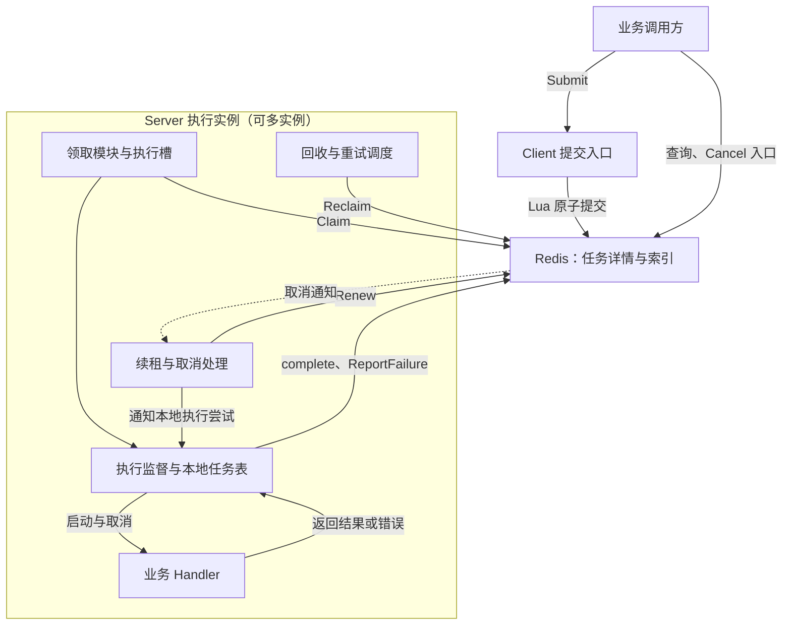

# TaskHarbor 项目概览

## 1. 项目简介

TaskHarbor 是一个使用 Go 开发的异步任务调度与执行平台。业务调用方提交任务，Server 实例从 Redis 领取任务并调用业务 Handler；平台维护任务生命周期，处理并发限制、租约续期、失败重试、取消和失联任务回收。

项目将业务处理与任务管理分开：Handler 实现业务，Redis 保存权威状态，调用方按任务 ID 查询状态和结果，无需在提交请求中等待执行完成。仓库模块为 `github.com/wang-kang-tuoinai/TaskHarbor`，Go 包名为 `taskq`。

本文描述第一版目标架构与业务流程，尚未全部实现；模块完成情况、实际测试及验证边界统一见[当前进度](当前进度.md)。

## 2. 项目目标与非目标

### 项目目标

- 作为展示 Go 后端与分布式系统能力的工程作品，能够解释并验证执行权、租约、并发竞争和故障恢复机制。
- 建立清晰的任务生命周期，让状态、执行身份和 Redis 索引保持一致。
- 支持多个 Server 实例处理同一逻辑队列，限制每个实例的本地 Handler 并发。
- 用可复现的测试覆盖正常执行、网络结果未知、旧 Worker 上报、取消竞争和租约回收等关键场景。
- 保持实现可读、可维护，围绕实际问题选择技术，避免提前构建通用框架。

### 第一版范围

| 能力 | 目标 |
| --- | --- |
| 提交与查询 | 提交任务、识别同 ID 的重复提交，按任务 ID 查询状态与结果 |
| 执行 | 注册 Handler、领取任务、限制本地并发，提交成功结果或失败原因 |
| 超时 | 启动 Handler 时开始本地执行计时，超时后停止续租、发出取消信号并上报失败 |
| 重试与回收 | 有限次数重试、租约到期回收、重试等待到期后重新进入待执行队列 |
| 取消 | 将非终态任务置为 canceled，并尽力通知执行实例 |
| 存储与队列 | 仅使用 Redis 和固定的 default 队列，由 Lua 原子维护任务详情与索引 |

核心操作为 Submit、Claim、complete、ReportFailure、Renew、Cancel、Reclaim。Server 指执行服务实例，调用入口不预设为独立 HTTP 服务或完整 SDK。

### 非目标与明确保留的边界

- 不引入 MySQL 或其他消息中间件，不实现跨存储双写。
- 工作流编排、周期任务、任务聚合、管理后台和多队列调度不属于第一版范围。
- 不承诺业务副作用恰好发生一次，也不承诺每个任务的 Handler 必定启动；授予执行权会消耗有限的尝试预算。
- 不强制终止不响应 context 的 goroutine；取消或超时不表示 Handler 已退出。
- 暂不解决取消通知先于本地登记导致 Handler 仍可能启动的窗口，也不实现 Server 本地租约有效期维护和迟到 Claim 响应保护。Redis 会拒绝失效身份的续租和上报，但旧 Handler 仍可能产生副作用。
- 不自动检测、对账或修复 Lua 部分写入。持久化、复制与故障恢复保证取决于另行明确的 Redis 部署配置，不承诺任何故障下都不丢任务。

## 3. 技术栈

| 技术 | 职责 |
| --- | --- |
| Go、goroutine、channel、sync | 任务执行、本地执行槽和共享状态管理 |
| context、time | 取消信号、单次执行超时、续租与回收调度 |
| Redis、Redis Lua、go-redis/v9 | 权威状态、索引、原子迁移和连接访问；按实例推送尽力而为的取消通知 |
| encoding/json、testing | 业务结果编码与测试验证 |

工具链和依赖版本以 [go.mod](../go.mod)、[go.sum](../go.sum) 为准，已验证的环境见[当前进度](当前进度.md)。

## 4. 整体架构

第一版由业务调用方、Client 提交入口、Server、业务 Handler 和 Redis 组成。一个进程可运行多个 Handler 协程，多个 Server 实例共享 default 队列。Server 内部模块是职责划分，不要求分别部署为服务。

| 组件 | 主要职责 |
| --- | --- |
| 业务调用方与调用入口 | 提供任务 ID、类型、参数和执行配置，提交、查询及取消任务 |
| Client 与 Redis 存储边界 | Client 校验提交参数并转换公开结果；内部存储包封装 keys、args、嵌入 Lua 和响应解析。Redis 连接由调用方配置和关闭，边界依据见 [ADR-0001](adr/0001-submit-client-and-storage.md) |
| 领取模块 | 先取得本地执行槽再发起 Claim；领取失败或无任务时释放本轮领取占用的槽 |
| 执行监督与本地任务表 | 按任务 ID 和执行令牌区分执行尝试，登记本地状态，监督 Handler、超时和实际退出，避免旧轮次清理影响新轮次 |
| 续租与取消处理 | 为本地明确管理的执行尝试续租，收到取消通知或明确失权后发出取消信号 |
| 回收与重试调度 | 在 Lua 中查找到期候选并迁移状态，允许多个 Server 实例并发触发 |
| Handler | 处理业务参数、设置结果、返回错误，并配合 context 取消 |

Redis 中的 pending、active 是索引，lease、retry 是 ZSET。active 和 lease 同时包含同一 running 任务属于正常情况。

| 数据 | 职责 |
| --- | --- |
| 任务详情 Hash | 保存不可变配置、状态、当前执行身份、结果和诊断信息 |
| pending 索引 | 当前可领取的任务，包括新任务和等待已到期的重试任务 |
| active 索引 | 当前处于 running 的任务 |
| lease ZSET | 以任务 ID 为 member，租约到期的 Unix 毫秒时间为 score |
| retry ZSET | 以任务 ID 为 member，允许重新进入 pending 的 Unix 毫秒时间为 score |

租约和重试到期时间只保存在各自 ZSET 的 score 中，不在任务详情重复保存。字段细则见[任务详情记录相关字段](任务详情记录相关字段.md)。

## 5. 核心业务流程

### 提交、领取与执行

1. Submit 原子检查同 ID 记录：不存在则创建并入队；初始配置一致则确认已有任务；不同则返回冲突。重复提交不重置状态或重新入队，成功确认不表示响应时任务仍在等待。
2. Server 先取得本地执行槽，再通过 Claim 原子领取任务，建立执行身份与初始租约，并增加一次尝试次数。在途 Claim 与尚未退出的 Handler 都占用执行槽。
3. Server 明确收到任务后登记执行尝试，按任务类型查找 Handler；启动 Handler 时才开始完整时长的本地执行计时，等待、领取与启动前准备时间不计入执行超时。
4. Server 为本地明确管理的执行尝试定期 Renew，续租不重置本地超时计时。

Claim 若已生效但响应丢失，不猜测任务身份、不为未知任务启动 Handler 或续租；该轮已消耗尝试预算，后续依靠租约回收。普通 Claim 不提供 Submit 式的请求幂等，不能进行不安全的透明重试。

### 成功、失败与超时

Handler 成功时调用 complete，失败时调用 ReportFailure；通过当前执行权校验后，分别进入 completed，或按剩余尝试额度进入 retry_wait / failed。

Handler 返回与本地超时只能选择一个结果分支。超时先发生时，Server 停止续租、取消 context 并上报失败，不再为该轮发起成功上报。取消信号不会强制结束 Handler，执行槽必须等 Handler 实际退出后只归还一次。

结果上报遇到网络或存储异常时按对应契约有界重试，最终放弃后停止续租；只有仍保有完整执行状态和索引的任务，才能由普通租约回收流程兜底。

### 重试与失联恢复

ReportFailure 或 Reclaim 读取任务保存的重试等待配置，以 Redis 当前时间计算重试到期时间。Reclaim 在同一 Lua 原子边界内选择候选、校验当前条件并迁移：租约到期的 running 按额度进入 retry_wait 或 failed，等待到期的 retry_wait 重新进入 pending。

重试不直接调用 Handler，必须重新经过 Claim，获得新的执行令牌并消耗下一次尝试预算。

### 取消与查询

Cancel 将 pending、retry_wait 或 running 直接置为 canceled，清理对应索引并撤销当前执行身份；对运行中的任务，按所属 Server 实例尽力发送取消通知。通知不保证送达，不设置独立取消标记，也不接受取消后的迟到上报。

查询以 Redis 中的状态与结果为准，不能以取消通知或本地内存代替权威状态。

| 操作 | 状态迁移 | 主要条件 |
| --- | --- | --- |
| Submit | 无记录 → pending | 首次合法提交 |
| Claim | pending → running | 有本地执行槽、任务可领取且有尝试额度 |
| Renew | running → running | 当前执行身份匹配、租约有效 |
| complete | running → completed | 当前执行权有效，成功上报被接受 |
| ReportFailure | running → retry_wait / failed | 当前执行权有效，按剩余额度决定目标 |
| Reclaim | running → retry_wait / failed | 租约到期，按剩余额度决定目标 |
| Reclaim | retry_wait → pending | 重试等待到期 |
| Cancel | 非终态 → canceled | 任务存在且未进入终态 |

completed、failed、canceled 均为终态，不因重复提交或迟到上报重新执行。具体输入输出与迁移条件以对应操作契约为准。

## 6. 核心设计原则

- **原子迁移**：当前条件检查、状态和执行身份修改、索引迁移必须处于同一 Lua 原子边界，不能依赖脚本外的过时判断。
- **执行权隔离**：任务 ID 标识逻辑任务，owner_id 标识执行实例，attempt_token 标识本轮尝试。续租和结果上报必须同时满足状态、令牌和有效租约校验；租约到期即失权，旧轮次不能修改新轮次。
- **尝试预算**：只有 Claim 授予执行权时消耗一次尝试；领取响应丢失或 Handler 尚未启动不退回额度，失败、回收和重新入队不额外增加次数。
- **时间与资源**：租约和重试到期判断使用 Redis 时间；执行超时由 Server 本地监督，不是 Redis 存储端的硬截止。停止续租、context 取消和 Handler 实际退出是不同事件，不能提前释放仍存活 Handler 的执行槽。
- **结果未知与业务幂等**：网络错误可能发生在生效前或生效后；Submit 可用相同 ID 和配置重试。平台的执行权保护不能撤销已经发生的业务副作用，业务仍需自行保证幂等。
- **原子性与持久性**：Lua 隔离执行不等于运行时错误回滚或数据持久化；写前完成必要检查，存储故障保证由明确的部署配置和恢复验证决定。

## 7. 代码目录说明

| 路径 | 职责 |
| --- | --- |
| [client.go](../client.go) | 公开 Client 提交入口、配置与结果转换 |
| [server.go](../server.go) | Task、Handler、Server 配置、生命周期状态和本地执行记录 |
| [internal/redisstore/](../internal/redisstore/) | Redis 操作封装、嵌入 Lua 脚本和响应解析 |
| 根目录及 internal 下的 `*_test.go` | 本地逻辑、响应解析与真实 Redis 集成测试 |
| [go.mod](../go.mod)、[go.sum](../go.sum) | 工具链和依赖配置 |
| [docs/](./) | 操作契约、字段说明、架构决策和项目状态 |
| [agents.md](../agents.md) | 项目开发约束与文档使用规则 |

## 8. 相关文档索引

| 文档 | 内容 |
| --- | --- |
| [当前进度](当前进度.md) | 已完成能力、实际验证、当前限制和下一步 |
| [任务详情记录相关字段](任务详情记录相关字段.md) | 任务字段分类、语义及 ZSET score 的存储职责 |
| [Submit 契约](Submit操作契约.md) | 参数、默认值与上限、原子提交、幂等、冲突和结果未知 |
| [Claim 契约](Claim操作契约.md) | 执行槽、领取、执行身份、尝试计数、租约及响应丢失 |
| [complete 契约](complete操作契约.md) | 成功上报、结果与终态写入、重复请求和有界重试 |
| [ReportFailure 契约](ReportFailure操作契约.md) | 失败与超时上报、尝试额度和重试调度 |
| [Renew 契约](Renew操作契约.md) | 单任务续租、执行权校验、租约到期与结果未知 |
| [Cancel 契约](Cancel操作契约.md) | 取消终态、索引清理、取消通知及启动衔接边界 |
| [Reclaim 契约](Reclaim操作契约.md) | 租约回收、重试到期迁移及多回收器竞争 |
| [ADR 索引](adr/README.md)、[ADR-0001](adr/0001-submit-client-and-storage.md) | 架构决策；Client Submit 接口与 Redis 存储边界 |
| [Submit 实施计划](Submit实施计划.md) | Submit 的实施要求、代码边界和验收场景 |

建议从本概览了解整体设计，再查当前进度和相关契约。契约中的验收场景是验证依据，不能据此推定全部实现或测试已经完成。
